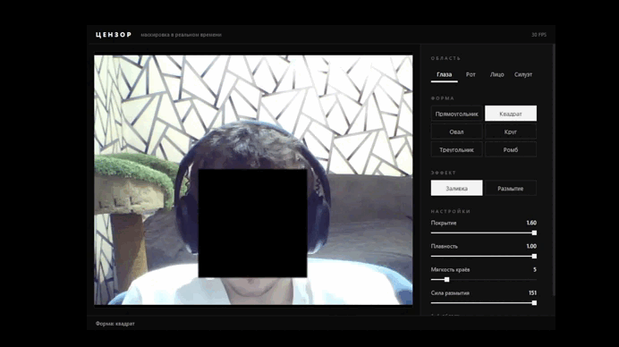

# Censor

Real-time face censoring for your webcam. It covers your eyes, mouth, face, or whole silhouette with a black fill or a blur. Everything runs locally: video is never recorded or sent anywhere.



## Features

- Regions: eyes, mouth, face, full-body silhouette
- Shapes: rectangle, square, oval, circle, triangle, diamond
- Effects: black fill or blur
- Live adjustments: coverage, smoothing, edge softness, blur strength

## Controls

| Key | Action |
|-----|--------|
| `1` | Eyes |
| `2` | Mouth |
| `3` | Face |
| `4` | Silhouette |
| `Q` or `Esc` | Quit |

## Installation

Requires Python 3.9–3.12 and a webcam.

Clone the repository, or download it with **Code → Download ZIP** and extract it:

```powershell
git clone https://github.com/GifFed/censor-cam.git
cd censor-cam
python -m venv venv
.\venv\Scripts\Activate.ps1
python -m pip install -r requirements.txt
python main.py
```
If activation fails with an execution policy error, run this once:

```powershell
Set-ExecutionPolicy -Scope CurrentUser RemoteSigned
```

A ready-made Windows `.exe` is available on the [Releases](../../releases) page.

## Privacy

Frames are processed in memory and never saved to disk. The app does not need an internet connection: MediaPipe models are bundled with the package.

## Project structure

- `censor/`: frame processing and shape geometry, independent of the UI
- `ui/`: PySide6 window and `style.qss` theme
- `main.py`: entry point

## Contributing

Contributions are welcome. Open an issue to discuss a change, then send a pull request. Please run `ruff check .` before submitting.

## License

MIT, see [LICENSE](LICENSE).
